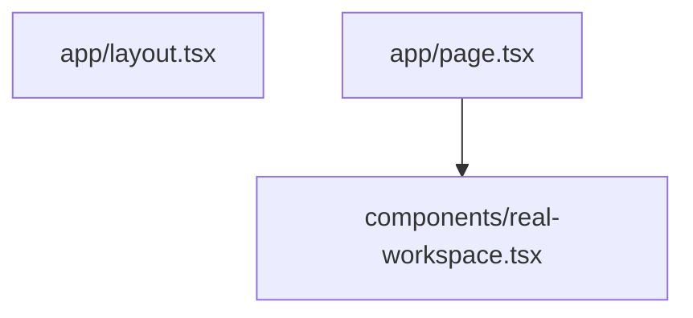
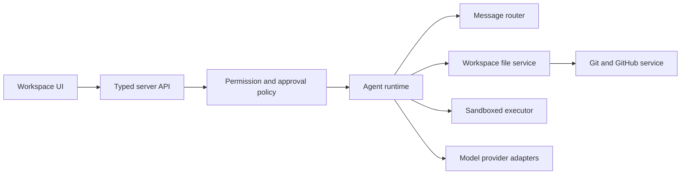

# Roveon architecture

Generated from the current TypeScript source tree with `npm run docs:architecture`.

## Runtime boundaries

- Next.js App Router renders the entrypoint in `app/page.tsx`.
- `components/real-workspace.tsx` is a client component that owns browser folder access and Monaco editing.
- Browser filesystem access is constrained to the directory selected through the File System Access API.
- No agent runtime, model provider, terminal executor, persistence layer, or server-side API is currently implemented.

## Source dependency graph

## Planned agent boundary

The planned boundary is documentation only until each service is implemented and verified.
